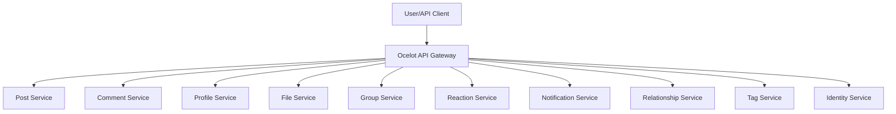
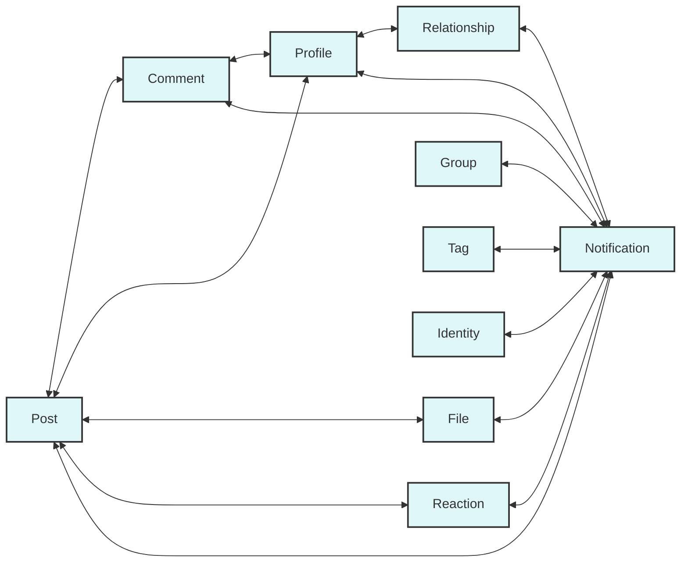

# InfinityNetServer - Microservices Backend

InfinityNetServer is a modular, production-ready backend system built with .NET, following a microservices architecture. It is designed for scalability, maintainability, and extensibility, supporting a wide range of social network features.

---

## Table of Contents
- [Project Overview](#project-overview)
- [Architecture](#architecture)
- [Technology Stack](#technology-stack)
- [Project Structure](#project-structure)
- [Microservice Conventions](#microservice-conventions)
- [Running the Project](#running-the-project)
- [Useful URLs & Credentials](#useful-urls--credentials)
- [Development & Contribution](#development--contribution)
- [Troubleshooting](#troubleshooting)

---

## Project Overview

InfinityNetServer is a microservices-based backend for social platforms, supporting user profiles, posts, comments, reactions, notifications, file storage, relationships, and more. Each domain is implemented as an independent microservice, communicating via gRPC and message queues (RabbitMQ).

## Architecture

### 1. High-Level System Overview


### 2. Microservice-to-Microservice Communication (gRPC)


### 3. Infrastructure & Dependencies

```mermaid
flowchart TB
  subgraph Microservices
    Post
    Comment
    Profile
    File
    Group
    Reaction
    Notification
    Relationship
    Tag
    Identity
  end
  RabbitMQ[("RabbitMQ")]
  PostgreSQL[("PostgreSQL")]
  MongoDB[("MongoDB")]
  MinIO[("MinIO")]
  Redis[("Redis")]
  ELK[("ELK Stack")]
  Grafana[("Grafana")]
  Prometheus[("Prometheus")]
  Loki[("Loki")]
  Tempo[("Tempo")]

  Post -- MQ --> RabbitMQ
  Comment -- MQ --> RabbitMQ
  Profile -- MQ --> RabbitMQ
  File -- MQ --> RabbitMQ
  Group -- MQ --> RabbitMQ
  Reaction -- MQ --> RabbitMQ
  Notification -- MQ --> RabbitMQ
  Relationship -- MQ --> RabbitMQ
  Tag -- MQ --> RabbitMQ
  Identity -- MQ --> RabbitMQ

  Post -- DB --> PostgreSQL
  Comment -- DB --> PostgreSQL
  Profile -- DB --> PostgreSQL
  File -- DB --> PostgreSQL
  Group -- DB --> PostgreSQL
  Reaction -- DB --> PostgreSQL
  Notification -- DB --> PostgreSQL
  Relationship -- DB --> PostgreSQL
  Tag -- DB --> PostgreSQL
  Identity -- DB --> PostgreSQL

  File -- ObjectStorage --> MinIO
  Profile -- NoSQL --> MongoDB

  Post -.-> ELK
  Comment -.-> ELK
  Profile -.-> ELK
  File -.-> ELK
  Group -.-> ELK
  Reaction -.-> ELK
  Notification -.-> ELK
  Relationship -.-> ELK
  Tag -.-> ELK
  Identity -.-> ELK

  Post -.-> Grafana
  Comment -.-> Grafana
  Profile -.-> Grafana
  File -.-> Grafana
  Group -.-> Grafana
  Reaction -.-> Grafana
  Notification -.-> Grafana
  Relationship -.-> Grafana
  Tag -.-> Grafana
  Identity -.-> Grafana

  Post -.-> Prometheus
  Comment -.-> Prometheus
  Profile -.-> Prometheus
  File -.-> Prometheus
  Group -.-> Prometheus
  Reaction -.-> Prometheus
  Notification -.-> Prometheus
  Relationship -.-> Prometheus
  Tag -.-> Prometheus
  Identity -.-> Prometheus

  Post -.-> Loki
  Comment -.-> Loki
  Profile -.-> Loki
  File -.-> Loki
  Group -.-> Loki
  Reaction -.-> Loki
  Notification -.-> Loki
  Relationship -.-> Loki
  Tag -.-> Loki
  Identity -.-> Loki

  Post -.-> Tempo
  Comment -.-> Tempo
  Profile -.-> Tempo
  File -.-> Tempo
  Group -.-> Tempo
  Reaction -.-> Tempo
  Notification -.-> Tempo
  Relationship -.-> Tempo
  Tag -.-> Tempo
  Identity -.-> Tempo

  Post -.-> Redis
  Comment -.-> Redis
  Profile -.-> Redis
  File -.-> Redis
  Group -.-> Redis
  Reaction -.-> Redis
  Notification -.-> Redis
  Relationship -.-> Redis
  Tag -.-> Redis
  Identity -.-> Redis

  classDef infra fill:#f9f,stroke:#333,stroke-width:2px;
  class RabbitMQ,PostgreSQL,MongoDB,MinIO,Redis,ELK,Grafana,Prometheus,Loki,Tempo infra;
```


- **Microservices**: Each business domain (e.g., Post, Comment, Profile, File, Group, Reaction, Notification, etc.) is a separate service.
- **API Gateway**: Ocelot is used as the API gateway for routing and aggregation.
- **gRPC**: Inter-service communication uses gRPC for high performance.
- **Message Bus**: RabbitMQ is used for asynchronous messaging and event-driven patterns.
- **Databases**: PostgreSQL and MongoDB are used for data storage. MinIO is used for file storage.
- **Observability**: ELK stack (Elasticsearch, Logstash, Kibana), Grafana, Prometheus, Loki, and Tempo are integrated for logging, metrics, and tracing.

## Technology Stack

- **.NET 8** (C#)
- **Docker & Docker Compose**
- **RabbitMQ** (message bus)
- **PostgreSQL** (relational DB)
- **MongoDB** (NoSQL DB)
- **MinIO** (S3-compatible object storage)
- **Redis** (caching, optional)
- **gRPC** (service-to-service communication)
- **Ocelot** (API Gateway)
- **ELK Stack, Grafana, Prometheus, Loki, Tempo** (monitoring & logging)

## Project Structure

- `BuildingBlocks/`: Shared base projects and utilities for all services (DTOs, contracts, common logic, proto files, etc.)
- `Services/`: Contains all microservices, each with the following structure:
  - `|MicroserviceName|.Application/`: Business logic, DTOs, gRPC clients/servers, consumers, exceptions, resources, helpers
  - `|MicroserviceName|.Domain/`: Entities, enums, repository interfaces
  - `|MicroserviceName|.Infrastructure/`: Database context, repository implementations, dependency injection
  - `|MicroserviceName|.Presentation/`: API controllers, configuration, middleware, mappers, exception handling
- `Ocelot.Presentation/`: API Gateway
- `Docker/`: Docker and infrastructure configuration (databases, monitoring, etc.)
- `docker-compose.yml`: Main Docker Compose file for all dependencies
- `net-server.sln`: Solution file for all .NET projects

## Microservice Conventions

- **Application Layer**: Handles business logic, DTOs, gRPC clients/servers, message consumers, exceptions, localization resources, helpers.
- **Domain Layer**: Contains entities, enums, and repository interfaces.
- **Infrastructure Layer**: Implements database context, repository implementations, dependency injection.
- **Presentation Layer**: Exposes REST APIs, configures middleware, handles exceptions, maps DTOs, and integrates with the API gateway.
- **Shared Code**: Any code used by more than one microservice should be moved to `BuildingBlocks/`.
- **Protobuf**: All `.proto` files are located in `BuildingBlocks/Application/Protos/`.

## Running the Project

### Prerequisites
- Docker & Docker Compose
- .NET 8 SDK

### Start All Dependencies

```fish
docker compose -f docker-compose.yml up -d
```

### Run Microservices
1. Open `net-server.sln` in Visual Studio or JetBrains Rider.
2. Start the required `|MicroserviceName|.Presentation` projects for the features you want to use.
3. (Optional) Start `Ocelot.Presentation` for API Gateway routing.

### Useful URLs & Credentials
- **Swagger UI**: http://localhost:60000/swagger/index.html (when Presentation projects are running)
- **RabbitMQ UI**: http://localhost:15672 (user: `infinitynetUser`, pass: `Password@123`)
- **PostgreSQL**: localhost:5432 (user: `infinitynetUser`, pass: `Password@123`)
- **MongoDB**: localhost:27017 (user: `infinitynetUser`, pass: `Password@123`)
- **MinIO**: http://localhost:9001 (user: `infinitynetUser`, pass: `Password@123`)
- **Grafana**: http://localhost:3000 (user: `infinitynetUser`, pass: `Password@123`)
- **Kibana**: http://localhost:5601
- **Redis Insight**: http://localhost:5540

## Development & Contribution

- Use the provided scripts in `package.json` for build, test, and clean:
  - `pnpm run build` - Build all .NET projects
  - `pnpm run test` - Run all tests
  - `pnpm run clean` - Clean build artifacts
  - `pnpm run restore` - Restore NuGet packages
- Follow the microservice conventions for new features.
- Add shared logic to `BuildingBlocks/` when needed.
- Use gRPC for inter-service communication and RabbitMQ for events.
- Document new APIs with Swagger annotations.

## Troubleshooting

- Ensure all Docker containers are running: `docker compose ps`
- Check logs for any service: `docker compose logs <service-name>`
- If a database is not reachable, check the corresponding container and network settings.
- For gRPC errors, ensure all dependent services are running and reachable.
- For more help, see the `Docker/` folder for service-specific configs.

---